# GuardVision AI: Comprehensive Architecture & Theoretical Knowledge Graph

This knowledge graph maps the complete architectural, algorithmic, and mathematical taxonomy of **GuardVision AI**. Use this structural map during your defense to show how raw sensor signals flow through mathematical transformations into real-time computer vision intelligence.

---

## 1. Master System Knowledge Graph (Mermaid Diagram)

```mermaid
graph TD
    %% INPUT & INGESTION LAYER
    subgraph INGESTION ["1. VIDEO INGESTION & NORMALIZATION LAYER"]
        CAM["Laptop Webcam (OpenCV Device 0)"] --> RAW["Raw Frame (Height x Width x 3)"]
        SNAP["Browser Camera Snapshot (HTML5 / Streamlit)"] --> RAW
        FALLBACK["Synthetic Offline Generator"] -.->|Auto-Fallback| RAW
        RAW --> RESIZE["Standardize Spatial Resolution (640 x 480)"]
        RESIZE --> FLIP["Horizontal Reflection (Mirror View: cv2.flip)"]
        FLIP --> COLOR_SWAP["Color Transposition: BGR to RGB (cv2.cvtColor)"]
    end

    %% CORE ENGINE & DISPATCHER
    subgraph ENGINE ["2. CORE EXECUTION ENGINE"]
        COLOR_SWAP --> DISPATCH["Filter Dispatcher Engine: dispatch_filter()"]
        SIDEBAR["Dynamic UI Controls (Streamlit Sidebar Sliders & Toggles)"] -->|Parameters p| DISPATCH
        CACHE["Resource Cache (@st.cache_resource)"] -->|Loaded Haar Models| DISPATCH
    end

    %% LEVEL 1: DIP FUNDAMENTALS
    subgraph DIP ["3. DIGITAL IMAGE PROCESSING (DIP) FOUNDATIONS"]
        DISPATCH --> M1["Module 1: Color Space Transforms"]
        DISPATCH --> M2["Module 2: 2D Spatial Filtering"]
        DISPATCH --> M3["Module 3: Edge & Gradient Operators"]
        DISPATCH --> M4["Module 4: Segmentation & Thresholding"]
        DISPATCH --> M5["Module 5: Mathematical Morphology"]
        DISPATCH --> M6["Module 6: Contrast & Histograms"]

        %% Module 1 Details
        M1 --> M1_GRAY["Rec. 601 Luma Grayscale: Y = 0.299R + 0.587G + 0.114B"]
        M1 --> M1_HSV["HSV Decoupling: Chromaticity (H, S) vs Intensity (V)"]
        M1 --> M1_LAB["CIELAB: Perceptually Uniform Color Space (L*, a*, b*)"]

        %% Module 2 Details
        M2 --> M2_GAUSS["Gaussian Blur: 2D Separable Kernel G(x,y) O(2K)"]
        M2 --> M2_MED["Median Filter: Non-Linear Rank Filter (Impulse Noise Removal)"]
        M2 --> M2_BILAT["Bilateral Filter: Edge-Preserving G_s(Euclidean) x G_r(Photometric)"]
        M2 --> M2_SHARP["High-Pass Spatial Sharpening Kernel"]

        %% Module 3 Details
        M3 --> M3_CANNY["Canny 5-Stage: Gaussian -> Sobel -> NMS -> Dual Threshold -> Hysteresis"]
        M3 --> M3_SOBEL["Sobel 1st Derivative: G_x (Vert), G_y (Horiz), Mag = sqrt(Gx² + Gy²)"]
        M3 --> M3_LAP["Laplacian 2nd Derivative: ∇²f (Isotropic Zero-Crossings)"]

        %% Module 4 Details
        M4 --> M4_BIN["Global Binary Cutoff: f(x,y) > T"]
        M4 --> M4_OTSU["Otsu's Threshold: Maximize Between-Class Variance σ_B²(t)"]
        M4 --> M4_ADAP["Adaptive Gaussian: Local Neighborhood T(x,y) = μ_local - C"]

        %% Module 5 Details
        M5 --> M5_EROSION["Erosion: A ⊖ B (Boundary Shrinkage & Noise Pruning)"]
        M5 --> M5_DILATION["Dilation: A ⊕ B (Boundary Expansion & Hole Bridging)"]
        M5 --> M5_OPEN["Opening: (A ⊖ B) ⊕ B (Speckle Removal, Shape Preservation)"]
        M5 --> M5_CLOSE["Closing: (A ⊕ B) ⊖ B (Crack Filling & Contour Smoothing)"]
        M5 --> M5_GRAD["Morphological Gradient: (A ⊕ B) - (A ⊖ B)"]

        %% Module 6 Details
        M6 --> M6_HE["Global Histogram Equalization: Transfer Function s_k = (L-1) * CDF"]
        M6 --> M6_CLAHE["CLAHE: Grid Tile Division + Clip Limit + Bilinear Interpolation"]
    end

    %% LEVEL 2: COMPUTER VISION APPLICATIONS
    subgraph CV ["4. HIGH-LEVEL COMPUTER VISION APPLICATIONS"]
        DISPATCH --> M7["Module 7: Real-Time Motion Detection"]
        DISPATCH --> M8["Module 8: Multi-Face & Eye Localization"]
        DISPATCH --> M9["Module 9: Contour & Shape Geometry"]

        %% Module 7 Details
        M7 --> M7_DIFF["Temporal Differencing: ΔI = |I_t - I_t-1|"]
        M7 --> M7_AVG["Running Background Model: B_t = (1-α)B_t-1 + αI_t (α=0.10)"]
        M7_AVG --> M7_THRESH["Binary Threshold + Dilation (2 Iterations)"]
        M7_THRESH --> M7_METRIC["Motion Activity Index (%): Scaled Foreground Pixel Sum"]

        %% Module 8 Details
        M8 --> M8_EQ["Illumination Equalization: cv2.equalizeHist(gray)"]
        M8_EQ --> M8_ENSEMBLE["Ensembled Classifiers: alt2 + default + profile"]
        M8_ENSEMBLE --> M8_VJ["Viola-Jones Core: Integral Image O(1) + AdaBoost Attentional Cascade"]
        M8_VJ --> M8_NMS["Non-Maximum Suppression (NMS): IoU Overlap Merge (θ=0.35)"]
        M8_NMS --> M8_SORT["Left-to-Right Sorting: FACE #1, FACE #2 Tracking"]
        M8_SORT --> M8_EYES["Constrained Eye ROI: Upper 65% of Face Box"]

        %% Module 9 Details
        M9 --> M9_SUZUKI["Suzuki-Abe Border Following: cv2.findContours(RETR_EXTERNAL)"]
        M9 --> M9_MOMENTS["Spatial Image Moments: M_pq = ∑∑ x^p y^q I(x,y)"]
        M9_MOMENTS --> M9_CENTROID["Centroid Extraction: x̄ = M_10 / M_00, ȳ = M_01 / M_00"]
        M9 --> M9_HULL["Convex Hull Generation: Sklansky / Monotone Chain O(N log N)"]
    end

    %% PRESENTATION & HUD LAYER
    subgraph OUTPUT ["5. SYNCHRONOUS PRESENTATION & TELEMETRY LAYER"]
        DIP --> RENDER["Synchronous Dual Viewport Layout"]
        CV --> RENDER
        RENDER --> OUT_LEFT["Left Viewport: Raw Ingested Camera Feed"]
        RENDER --> OUT_RIGHT["Right Viewport: Processed Computer Vision Filter"]
        RENDER --> TELEMETRY["Live Telemetry HUD: FPS, Centroids, Face Count, Motion Index"]
        RENDER --> THEORY["Collapsible Mathematical Foundations (KaTeX Formulations)"]
        RENDER --> GALLERY["Multi-Filter Comparison Gallery (6 Simultaneous Algorithms)"]
    end

    %% STYLING
    classDef inputNode fill:#1E293B,stroke:#38BDF8,stroke-width:2px,color:#F8FAFC;
    classDef engineNode fill:#0F172A,stroke:#6366F1,stroke-width:2px,color:#F8FAFC;
    classDef dipNode fill:#1E293B,stroke:#10B981,stroke-width:2px,color:#F8FAFC;
    classDef cvNode fill:#1E293B,stroke:#F59E0B,stroke-width:2px,color:#F8FAFC;
    classDef outNode fill:#0F172A,stroke:#EC4899,stroke-width:2px,color:#F8FAFC;

    class CAM,SNAP,FALLBACK,RAW,RESIZE,FLIP,COLOR_SWAP inputNode;
    class DISPATCH,SIDEBAR,CACHE engineNode;
    class M1,M2,M3,M4,M5,M6,M1_GRAY,M1_HSV,M1_LAB,M2_GAUSS,M2_MED,M2_BILAT,M2_SHARP,M3_CANNY,M3_SOBEL,M3_LAP,M4_BIN,M4_OTSU,M4_ADAP,M5_EROSION,M5_DILATION,M5_OPEN,M5_CLOSE,M5_GRAD,M6_HE,M6_CLAHE dipNode;
    class M7,M8,M9,M7_DIFF,M7_AVG,M7_THRESH,M7_METRIC,M8_EQ,M8_ENSEMBLE,M8_VJ,M8_NMS,M8_SORT,M8_EYES,M9_SUZUKI,M9_MOMENTS,M9_CENTROID,M9_HULL cvNode;
    class RENDER,OUT_LEFT,OUT_RIGHT,TELEMETRY,THEORY,GALLERY outNode;
```



---

## 2. Hierarchical Taxonomy & Mathematical Entity Map

### Layer 1: Ingestion & Geometric Normalization
* **Physical Device:** Ingestion from hardware camera (`cv2.VideoCapture(0)`) or browser snapshot.
* **Spatial Normalization:** Rescaling from arbitrary sensor resolution to $640 \times 480$ via bilinear interpolation.
* **Reflective Invariance:** Horizontal mirror flip along the vertical axis ($x' = W - 1 - x$).
* **Channel Transposition:** 
  $$\begin{bmatrix} R \\ G \\ B \end{bmatrix} = \begin{bmatrix} 0 & 0 & 1 \\ 0 & 1 & 0 \\ 1 & 0 & 0 \end{bmatrix} \begin{bmatrix} B \\ G \\ R \end{bmatrix}$$

---

### Layer 2: Digital Image Processing (Low-to-Mid Level Transformations)

```
DIP Foundations
 ├── 1. Photometric Spaces
 │    ├── ITU-R BT.601: Y = 0.299R + 0.587G + 0.114B (Spectral cone sensitivity)
 │    ├── HSV: Cylindrical coordinate decoupling of chromaticity (H, S) from luma (V)
 │    └── CIELAB: Perceptually uniform metric (ΔE Euclidean matching perceived distance)
 │
 ├── 2. Spatial Convolution & Filtering
 │    ├── 2D Discrete Convolution: g(x,y) = ∑∑ h(s,t) * f(x-s, y-t)
 │    ├── Gaussian Blur: G(x,y) = [2πσ²]⁻¹ exp(-(x²+y²)/(2σ²)) [Separable: O(2K) vs O(K²)]
 │    ├── Median Filter: Non-linear rank order statistic (impulse Salt & Pepper suppression)
 │    └── Bilateral Filter: I(p) = ∑ I(q) * G_σs(||p-q||) * G_σr(|I(p)-I(q)|) [Edge-preserving]
 │
 ├── 3. Edge & Differential Operators
 │    ├── 1st Order (Sobel): Gx, Gy central differences -> Magnitude |∇I| = √(Gx² + Gy²), θ = atan2(Gy, Gx)
 │    ├── 2nd Order (Laplacian): ∇²f = ∂²f/∂x² + ∂²f/∂y² (Zero-crossing edge localization)
 │    └── Canny 5-Stage: Gaussian -> Gradient -> Non-Maximum Suppression -> Dual Threshold -> Hysteresis Tracking
 │
 ├── 4. Segmentation & Thresholding
 │    ├── Global Threshold: f(x,y) > T
 │    ├── Otsu's Algorithm: Maximize between-class variance σ_B²(t) = ω0(t)ω1(t)[μ0(t)-μ1(t)]² in O(L) time
 │    └── Adaptive Gaussian: Local neighborhood threshold T(x,y) = μ_local(x,y) - C
 │
 ├── 5. Mathematical Morphology
 │    ├── Erosion: A ⊖ B = {z | (B)_z ⊆ A}
 │    ├── Dilation: A ⊕ B = {z | (B̂)_z ∩ A ≠ ∅}
 │    ├── Opening: (A ⊖ B) ⊕ B (Removes foreground noise, retains shape size)
 │    ├── Closing: (A ⊕ B) ⊖ B (Fills internal holes and bridges boundary fractures)
 │    └── Morphological Gradient: (A ⊕ B) - (A ⊖ B) (Exact 2-pixel boundary perimeter)
 │
 └── 6. Histogram Processing
      ├── Global Equalization: Transfer function s_k = (L-1) * ∑ p_r(r_j) (CDF mapping)
      └── CLAHE: Contextual tiles (8x8) + Histogram clipping at clipLimit + Bilinear interpolation
```

---

### Layer 3: High-Level Computer Vision Applications

```
Computer Vision Applications
 ├── 1. Real-Time Temporal Motion Detection
 │    ├── 2-Frame Difference: Δ = |I_t - I_t-1| (Leading/trailing edge response)
 │    ├── Running Background Average: B_t = (1-α)B_t-1 + αI_t (α=0.10 persistent model)
 │    ├── Morphological Noise Suppression: Dilation iterations = 2
 │    └── Motion Activity Index: (∑ Contour Area / Frame Area) * 100 * 2.5
 │
 ├── 2. Multi-Subject Face Localization
 │    ├── Pre-processing: cv2.equalizeHist(gray) (Illumination normalization across subjects)
 │    ├── Viola-Jones Framework:
 │    │    ├── Haar-like Features: Rectangle intensity sums
 │    │    ├── Integral Image: Sum(D) = ii(x4,y4) + ii(x1,y1) - ii(x2,y2) - ii(x3,y3) in O(1)
 │    │    ├── AdaBoost: Linear combination of selected weak classifiers
 │    │    └── Attentional Cascade: Early rejection of non-face background windows (>50% rejected per early stage)
 │    ├── Multi-Cascade Ensemble: alt2 + default + profile classifiers
 │    ├── Non-Maximum Suppression (NMS): IoU = Area(B1 ∩ B2) / Area(B1 ∪ B2) with threshold θ = 0.35
 │    ├── Spatial Sorting: Left-to-right sorting along x-axis (FACE #1, FACE #2)
 │    └── Constrained Eye ROI: Upper 65% of face bounding box (Prevents nostril/mouth false positives)
 │
 └── 3. Contour Geometry & Topological Extraction
      ├── Border Tracking: Suzuki-Abe border following (cv2.RETR_EXTERNAL, CHAIN_APPROX_SIMPLE)
      ├── Spatial Image Moments: M_pq = ∑∑ x^p y^q I(x,y)
      ├── Centroid of Mass: x̄ = M_10 / M_00, ȳ = M_01 / M_00
      └── Convex Hull: Smallest enclosing convex polygon via Sklansky's algorithm in O(N log N)
```

---

## 3. How to Present This Knowledge Graph to Your Professor (3-Minute Script)

When your professor asks you to give an overview of the system, open this file or draw this 4-tier flow:

1. **Tier 1 (Signal Ingestion):**
   > *"Professor, the bottom of our graph starts with raw physical photons arriving at the camera sensor. OpenCV captures this in BGR format at $640 \times 480$. We standardize resolution, flip horizontally for natural user interaction, and transpose color channels to standard sRGB."*

2. **Tier 2 (DIP Mathematical Foundations):**
   > *"The ingested signal enters our central dispatch engine. Here, the student can explore 6 low-level signal processing domains: Photometric Color Spaces (Rec. 601 Luma, HSV, CIELAB), 2D Spatial Convolutions (Separable Gaussian, Median, and Bilateral edge-preserving filtering), Differential Edge Operators (Canny and Sobel), Image Segmentation (Otsu variance maximization and Adaptive Gaussian), Mathematical Morphology, and Contrast Equalization (CLAHE)."*

3. **Tier 3 (High-Level Computer Vision Applications):**
   > *"Building upon those fundamental DIP primitives, we have 3 real-time computer vision applications:
   > 1. **Temporal Motion Detection**, which uses an adaptive running background average model $B_t = (1-\alpha)B_{t-1} + \alpha I_t$.
   > 2. **Multi-Subject Face Localization**, which leverages the Viola-Jones framework with an Integral Image for $\mathcal{O}(1)$ rectangular sums, AdaBoost cascade filtering, contrast equalization, an ensemble of classifiers, and custom Non-Maximum Suppression (NMS) to track multiple subjects simultaneously.
   > 3. **Contour Geometry**, which applies Suzuki-Abe topological border tracing, image moments for centroid calculation, and convex hull generation."*

4. **Tier 4 (Presentation & Telemetry Layer):**
   > *"Finally, everything is output synchronously side-by-side with live telemetry displaying FPS, centroids, face counts, and motion percentages."*
