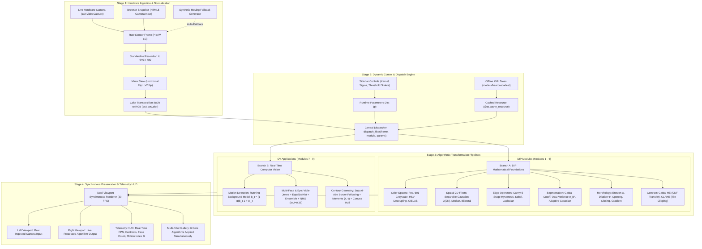

# GuardVision Lab: Interactive Digital Image Processing (DIP) & Computer Vision (CV) Studio

[](https://www.python.org/)
[](https://streamlit.io/)
[](https://opencv.org/)

An interactive, real-time Computer Vision and Digital Image Processing engineering studio built with **Python, Streamlit, and OpenCV**. Featuring live webcam ingestion, dynamic algorithm parameter tuning, side-by-side comparative visualization, mathematical theory, and real-time computer vision analysis.

---

## System Architecture & Pipeline Flowchart

Use this diagram to trace the complete end-to-end dataflow from raw physical sensor input through mathematical transformations to real-time visualization:



### How to Explain This Flowchart to Your Professor (60-Second Walkthrough)

1. **Point to Stage 1 (Top):** *"Professor, our pipeline starts with frame ingestion. Regardless of whether frames come from a live hardware camera or browser snapshot, we normalize the resolution to $640 \times 480$, apply a mirror flip for natural user interaction, and transpose the memory layout from OpenCV's native BGR to sRGB."*
2. **Point to Stage 2 (Middle-Left):** *"Next, the frame enters our central `dispatch_filter()` engine, which couples the incoming image with runtime parameters dynamically tuned via the sidebar sliders (like Gaussian kernel size or Canny thresholds) and pre-cached Haar feature trees."*
3. **Point to Stage 3 (Middle):** *"The engine routes the frame into one of two algorithmic branches:  
   - **Branch A (DIP Foundations):** Evaluates mathematical transformations (Rec. 601 Luma, separable Gaussian convolution, Canny 5-stage hysteresis, Otsu variance maximization, morphology, and CLAHE).  
   - **Branch B (Computer Vision):** Executes higher-level perception—temporal motion detection using a running background model, multi-subject face and eye localization using Viola-Jones with NMS deduplication, and contour boundary extraction with spatial image moments."*
4. **Point to Stage 4 (Bottom):** *"Finally, both the raw camera feed and the processed output are rendered side-by-side at 30 FPS alongside live telemetry showing FPS, centroids, and detection metrics."*

---

## Key Features & Demonstration Modules

### 1. Digital Image Processing (DIP) Fundamentals
- **Color Space Conversions**:
  - RGB to Grayscale (Rec. 601 luma weighting: $Y = 0.299R + 0.587G + 0.114B$).
  - HSV Color Space with individual Hue, Saturation, and Value channel inspection.
  - CIELAB Perceptual Color Space ($L^*$, $a^*$, $b^*$).
  - YCrCb Digital Video Encoding.
- **Spatial 2D Filtering & Smoothing**:
  - **Gaussian Blur**: 2D Gaussian kernel with interactive kernel size ($3 \dots 35$) and standard deviation ($\sigma$).
  - **Median Blur**: Non-linear ranking filter for salt-and-pepper impulse noise removal.
  - **Bilateral Filter**: Non-linear, edge-preserving smoothing combining spatial closeness with radiometric photometric similarity.
  - **Spatial Sharpening**: High-pass filter kernel boosting edge gradients.
- **Edge Detection & Gradient Operators**:
  - **Canny Edge Detector**: Full 4-stage pipeline (Gaussian smooth, gradient magnitude/angle, Non-Maximum Suppression, hysteresis thresholding with dual sliders).
  - **Sobel Operator**: First-order derivative filters ($G_x$ vertical edges, $G_y$ horizontal edges, combined gradient magnitude $\sqrt{G_x^2 + G_y^2}$).
  - **Laplacian Operator**: Second-order isotropic derivative filter highlighting rapid intensity discontinuities.
- **Image Segmentation & Thresholding**:
  - **Global Binary Thresholding**: Interactive threshold cutoff ($T \in [0, 255]$) with inverted binary masking.
  - **Otsu’s Optimal Thresholding**: Automatic threshold calculation via between-class variance maximization ($\sigma_B^2$).
  - **Adaptive Gaussian Thresholding**: Local neighborhood thresholding for uneven illumination.
- **Mathematical Morphology**:
  - Dilation, Erosion, Morphological Opening, Closing, and Morphological Gradient with customizable structuring elements (Rectangle, Ellipse, Cross) and iterations.
- **Contrast & Histograms**:
  - CLAHE (Contrast Limited Adaptive Histogram Equalization) preventing noise over-amplification.
  - Global Histogram Equalization.

### 2. Computer Vision (CV) Applications
- **Real-Time Temporal Motion Detection**:
  - Consecutive frame differencing ($\Delta I_t = |I_t - I_{t-1}| > \theta$) with thresholding, morphological noise suppression, contour grouping, and dynamic green/red bounding boxes.
  - Real-time **"Motion Activity Index (%)"** progress bar and metric.
- **Multi-Subject Face & Eye Localization**:
  - Real-time simultaneous multi-face detection using ensembled Haar Cascades with NMS, histogram equalization, center coordinates, and eye tracking.
- **Contour Analysis & Geometric Shape Extraction**:
  - Border traversal, area/perimeter computation, bounding rectangle fitting, and convex hull generation.

### 3. Core Capabilities
- **Side-by-Side Comparative View**: Displays the live raw webcam feed on the left and the processed DIP filter on the right.
- **Mathematical Theory Foundations**: Collapsible panel displaying KaTeX formulas and theoretical explanations for each technique.
- **Dual Stream Ingestion**: Live laptop webcam (`cv2.VideoCapture(0)`) with automatic fallback to an offline synthetic moving generator if the webcam is blocked or unavailable.

---

## Quickstart Guide

### 1. Installation

Clone or open the project folder in your terminal:

```bash
# 1. Create and activate a Python virtual environment
python3 -m venv .venv
source .venv/bin/activate  # On Windows: .venv\Scripts\activate

# 2. Install dependencies
pip install -r requirements.txt
```

### 2. Launch the Application Locally

Run this command:

```bash
streamlit run app.py
```

The application will immediately launch in your browser at:
👉 **[http://localhost:8501](http://localhost:8501)**
