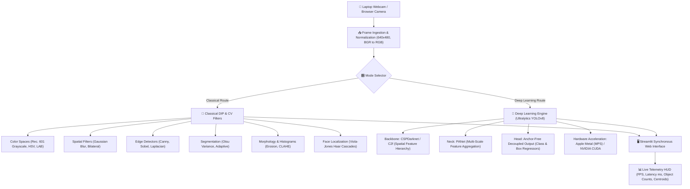

# Real-Time Deep Learning & Computer Vision Inspection System

[](https://www.python.org/)
[](https://streamlit.io/)
[](https://opencv.org/)
[](https://pytorch.org/)
[](https://docs.ultralytics.com/)

A high-performance, real-time Computer Vision inspection and demonstration workbench built with **Streamlit, OpenCV, and PyTorch/YOLO**. The system implements a hybrid processing pipeline that bridges classical Digital Image Processing (DIP) techniques with modern Deep Learning (CNN) object detection for live webcam streams.

---

## 1. System Architecture & Data Flow

The application captures frames from a hardware webcam or browser camera, normalizes spatial dimensions, and routes the signal through either a classical pixel-level DIP pipeline or a deep neural tensor engine:

```
[ Laptop Webcam ] ───> [ Frame Ingestion ] ───> [ Mode Selector ]
                                                      ├──> [ Classical CV / DIP Filters ]
                                                      └──> [ Deep Learning Engine (YOLO) ]
                                                               │
                                                               ▼
                                                        [ Streamlit Web UI ]
```

### End-to-End Pipeline Flowchart



---

## 2. Core Modules & Technologies Explained Simply

### 1. Streamlit Frontend
- **Role:** Lightweight, interactive graphical user interface.
- **How it works:** Provides reactive sidebar sliders and dropdown menus allowing users to dynamically adjust algorithm parameters (such as Gaussian kernel size, Canny thresholds, or YOLO confidence cutoffs) and view live side-by-side video feeds without re-compiling code.

### 2. OpenCV & Digital Image Processing (DIP)
- **Role:** Deterministic, pixel-level mathematical operations.
- **Key Techniques:**
  - **Color Spaces:** Converts BGR to Grayscale via ITU-R Rec. 601 luma weighting ($Y = 0.299R + 0.587G + 0.114B$) and HSV for lighting-invariant color tracking.
  - **Spatial Filtering:** Gaussian Blur 2D separable convolution ($G(x,y)$) for noise suppression; Bilateral filter for edge-preserving smoothing.
  - **Edge Detection:** Multi-stage Canny operator (Gaussian smooth $\to$ gradient magnitude $\to$ non-maximum suppression $\to$ dual-threshold hysteresis).
  - **Segmentation & Morphology:** Otsu’s bimodal thresholding maximizing between-class variance ($\sigma_B^2$); morphological opening and closing to eliminate noise artifacts.
  - **Classical Object Localization:** Viola-Jones AdaBoost cascade classifiers using Integral Images for rapid facial feature detection in $\mathcal{O}(1)$ time.

### 3. Deep Learning Engine (Ultralytics YOLO & PyTorch)
- **Role:** Modern semantic object detection, bounding box regression, and classification.
- **How it works:** Uses a single-stage Convolutional Neural Network (CNN) that inspects the entire frame in one forward tensor pass. The network predicts bounding box coordinates and class probabilities across 80 COCO categories simultaneously, without needing separate region proposal passes.

---

## 3. Professor Defense & Evaluation Cheatsheet

Use this quick-reference guide during oral defense, viva voce, or laboratory evaluation:

### 1. How Convolutional Layers Extract Spatial Features
* **Low-Level Layers:** Early convolution kernels act similarly to Sobel filters, computing spatial gradients to extract basic lines, sharp edges, and color transitions.
* **Mid-Level Layers:** Intermediate feature maps combine simple edges into geometric textures, corners, and localized shapes.
* **High-Level Layers:** Deep layers assemble textures into complex semantic object representations (e.g., eyes, wheels, faces, keyboards) that are robust to rotation, scale, and illumination changes.

### 2. Traditional Pixel-Differencing vs. Deep Neural Detection
| Feature | Traditional Pixel-Differencing (Module 7) | Deep Neural Detection (Module 10 - YOLO) |
|---|---|---|
| **Mechanism** | Temporal subtraction: $\Delta I_t = |I_t - I_{t-1}| > \theta$ | Multi-scale convolutional tensor evaluation |
| **Detection Scope** | Detects **any moving pixels** (cannot identify what the object is) | Recognizes **specific object categories** (stationary or moving) |
| **Environmental Robustness** | Easily triggered by light flickers, shadows, and camera shake | Invariant to lighting changes, shadows, and background movement |
| **Semantic Awareness** | None (only pixel coordinates of active motion clusters) | Full classification across 80 classes with confidence percentages |

### 3. Classical Viola-Jones vs. Deep Learning (YOLOv8)
| Criterion | Viola-Jones Haar Cascades (Module 8) | YOLOv8 Deep Learning (Module 10) |
|---|---|---|
| **Feature Type** | Handcrafted rectangular Haar-like intensity sums | Learned hierarchical convolutional feature maps |
| **Computation** | Evaluated via Integral Image in $\mathcal{O}(1)$ time on CPU | Matrix/tensor operations accelerated on GPU (Apple Metal MPS / CUDA) |
| **Pose Tolerance** | Strictly upright, frontal faces ($< 15^\circ$ tilt) | Arbitrary rotations, 3D poses, and extreme viewing angles |
| **Occlusion Robustness** | Easily broken if key landmarks (eyes/nose bridge) are blocked | Maintains high detection recall under heavy partial occlusions |

### 4. Real-Time Performance & Latency Telemetry
- **Hardware Acceleration:** Native Apple Silicon Metal Performance Shaders (`device='mps'`) or NVIDIA CUDA.
- **Steady-State Latency:** **$12.9\text{ ms} - 16.5\text{ ms}$** per frame for YOLOv8 Nano (`yolov8n.pt`).
- **Throughput:** ~**60–75 FPS** tensor throughput, ensuring smooth real-time performance at 30 FPS webcam capture rate.

---

## 4. Quick-Start Guide

### Prerequisites
- Python 3.10, 3.11, 3.12, or 3.13
- A standard laptop webcam

### 1. Clone & Set Up Virtual Environment

```bash
# Clone the repository
git clone https://github.com/Haus-Nous/guardvision-ai.git
cd guardvision-ai

# Create and activate virtual environment
python3 -m venv .venv
source .venv/bin/activate  # On Windows: .venv\Scripts\activate
```

### 2. Install Dependencies

```bash
pip install -r requirements.txt
```

### 3. Run the Application

```bash
streamlit run app.py
```

The application will launch in your default browser at:  
👉 **[http://localhost:8501](http://localhost:8501)**

---

## 5. Supplementary Academic Documentation

For complete theoretical derivations, viva voce Q&A, and systemic flowcharts, consult the project knowledge assets:

- 📘 **[VIVA_QUESTIONS_AND_ANSWERS.md](VIVA_QUESTIONS_AND_ANSWERS.md)**: 35 curated viva examination questions and model answers covering both DIP mathematics and deep learning theory.
- 🗺️ **[KNOWLEDGE_GRAPH.md](KNOWLEDGE_GRAPH.md)**: Master architectural knowledge graph and 3-minute oral defense script for faculty evaluation.
